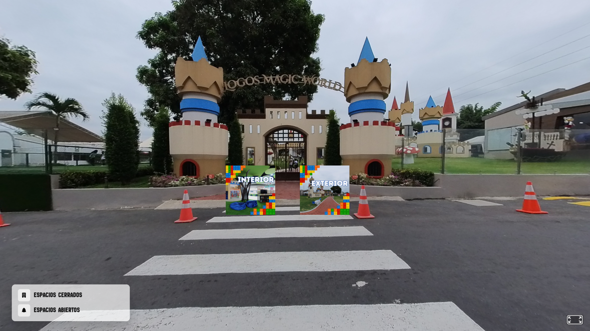

# LogosVirtualTour

[](https://logosvirtualtour.netlify.app/)

An interactive, responsive 360-degree virtual tour and campus exploration web application built for **Logos Academy**. Provides prospective students and visitors with an immersive, self-guided panoramic walkthrough of educational facilities, classrooms, sports complexes, and laboratories.

🌐 **Live Deployment:** [https://logosvirtualtour.netlify.app/](https://logosvirtualtour.netlify.app/)



<div align="center">
  
  
  
  
  
</div>

---

## Features

### 🌐 360° Panoramic Exploration
- Interactive spherical viewpoints with smooth cursor-driven panning and touch drag gestures.
- High-fidelity visual rendering of key school landmarks.

### 🗺️ Multi-Facility Campus Navigation
- Hotspot teleportation links allowing seamless traversal between distinct campus zones:
  - Primary and High School buildings
  - Science & Technology Laboratories
  - Athletic Fields & Courts
  - Library & Administrative Hubs

### 📱 Responsive Desktop & Mobile Design
- Optimized viewport handling across smartphones, tablets, and desktop displays.
- Lightweight vanilla JavaScript architecture with zero heavy library overhead for instantaneous load times.

---

## Project Structure

```
TOUR VIRTUAL/
├── index.html       # Primary landing page and main campus tour entrypoint
├── index2.html      # Secondary facility navigation view
├── style.css        # Responsive styling and modal overlays
├── script.js        # Interactive panorama viewer and hotspot event handlers
├── assets/          # Panorama images, icons, and UI assets
│   └── preview.png  # Application screenshot preview
├── morepags/        # Supplemental facility view pages
└── slider-imgs/     # Gallery and slider visual media
```

---

## Getting Started

### Local Setup
No build tools or dependency installations required. Run directly in any modern browser:

```bash
# Clone the repository
git clone https://github.com/adriangbustos/LogosVirtualTour.git
cd LogosVirtualTour

# Serve locally using Python
python -m http.server 8080
```
Open `http://localhost:8080` in your web browser.

---

## License

This project is licensed under the MIT License - see the [LICENSE](LICENSE) file for details.
